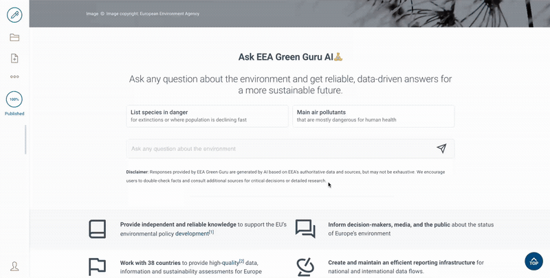

# @eeacms/volto-eea-chatbot

[](https://github.com/eea/volto-eea-chatbot/releases)

[Volto](https://github.com/plone/volto) add-on that integrates an AI-powered chatbot with a customizable interface and advanced settings to tailor its behavior and enhance user interactions.

## Upgrade

**1.0.0 (Breaking)** - This release introduces breaking changes to the chatbot configuration and API endpoints, making it compatible with Onyx v2.

## Features



The **Volto Chatbot** block allows the integration of an AI-powered chatbot into your Volto project. It offers a customizable interface and advanced settings to tailor the chatbot's behavior to your needs. Below is an overview of its features and configuration options.

---

## Functionalities

| **Property**                 | **Description**                                                                 | **Type** | **Default**                      |
| ---------------------------- | ------------------------------------------------------------------------------- | -------- | -------------------------------- |
| `assistant`                  | Choose from the list of available assistants configured in the application.     | Dropdown | -                                |
| `qgenAsistantId`             | Select an assistant for generating related questions.                           | Dropdown | -                                |
| `enableQgen`                 | Toggle the generation of related questions.                                     | Boolean  | `false`                          |
| `enableFeedback`             | Enable or disable thumbs up/down feedback for assistant responses.              | Boolean  | `true`                           |
| `enableMatomoTracking`       | Enable tracking of user interactions via Matomo Analytics.                      | Boolean  | `true`                           |
| `enableShowTotalFailMessage` | Show total failure message.                                                     | Boolean  | `false`                          |
| `showAssistantTitle`         | Display or hide the assistant's title in the chat interface.                    | Boolean  | `true`                           |
| `showAssistantDescription`   | Display or hide the assistant's description in the chat interface.              | Boolean  | `true`                           |
| `qualityCheck`               | Show automated fact-checking of AI answers against source documents.            | Dropdown | `Disabled`                       |
| `onDemandInputToggle`        | Sets the default state of the fact-check AI toggle.                             | Boolean  | `true`                           |
| `showTools`                  | Show or hide tools in the chat interface.                                       | Array    | `["internal_search_tool_start"]` |
| `scrollToInput`              | Automatically scroll the page to focus on the chat input when interacting.      | Boolean  | `false`                          |
| `showAssistantPrompts`       | Show or hide predefined prompts provided by the assistant.                      | Boolean  | `true`                           |
| `enableStarterPrompts`       | Define custom prompts to initiate a chat with the assistant.                    | Boolean  | `false`                          |
| `starterPromptsHeading`      | Heading shown above the prompts.                                                | String   | -                                |
| `starterPromptsPosition`     | Prompts position.                                                               | Dropdown | `Top`                            |
| `placeholderPrompt`          | Set placeholder text for the chat input field.                                  | String   | `Ask a question`                 |
| `chatTitle`                  | Title assigned to saved chats, visible only in Onyx or analytics.               | String   | `Online public chat`             |
| `height`                     | Set the height of the chat window using CSS dimensions (e.g., `500px`, `70vh`). | String   | -                                |

---

## Copy and related-question analytics

When `enableMatomoTracking` is enabled, successful answer copies emit
`Response copied` under `Chatbot` or
`Chatbot - <persona name>`. Failed/unavailable clipboard writes and repeated
activations during a pending write do not emit successful-copy events.
The shared `UserActionsToolbar` accepts an optional `matomoCategory` override;
Advanced Search uses `Search - AI summary` for its copy and feedback events.

Related questions retain the existing `Chatbot: Related question click` event
with name `Message submitted`, including keyboard activation. Loading and
tracking-disabled states do not emit it. Neither event includes the answer or
suggested-question text. These events use `@eeacms/volto-matomo/utils` and the
site's existing tracker configuration.

## Requirements

### Backend

- [Plone](https://plone.org/download)
- [plone.restapi](https://pypi.org/project/plone.restapi/)

### Frontend

- Node.js: `>=22.0.0`

## Installation

1. Make sure you have a [Plone backend](https://plone.org/download) up-and-running at http://localhost:8080/Plone

   ```Bash
   docker compose up backend
   ```

1. Start Volto frontend

- If you already have a volto project, just update `package.json`:

  ```JSON
  "addons": [
      "@eeacms/volto-eea-chatbot"
  ],

  "dependencies": {
      "@eeacms/volto-eea-chatbot": "*"
  }
  ```

- If not, create one with Cookieplone, as recommended by the official Plone documentation for Volto 18+:

  ```
  uvx cookieplone project
  cd project-title
  ```

1. Install or update dependencies, then start the project:

   ```
   make install
   ```

   For a Cookieplone project, start the backend and frontend in separate terminals:

   ```
   make backend-start
   make frontend-start
   ```

## Block presentation variations

Since 4.1.0 the chatbot block's presentation is pluggable. The block ships with the default `classic` presentation (the standard chat window), and other add-ons can register additional presentations ("variations") — e.g. to re-style the chat, replace the sources UI, or render custom elements inline in the assistant's answer. When two or more variations are registered, Volto core automatically adds a **Presentation** choice field to the block's edit sidebar, so editors can pick the variation per block. Old block content without a `variation` value keeps resolving to the default.

### Registering a variation

Push your variation onto `blocksConfig.eeaChatbot.variations` from your add-on's `applyConfig` (same cross-add-on pattern as `volto-tabs-block`):

```js
export default function applyConfig(config) {
  const block = config.blocks.blocksConfig.eeaChatbot;
  if (block) {
    block.variations = block.variations || [];
    if (!block.variations.find((v) => v.id === 'catalogue')) {
      block.variations.push({
        id: 'catalogue',
        title: 'Catalogue',
        isDefault: false,
        view: CatalogueChatView,
      });
    }
  }
  return config;
}
```

A variation is `{ id, title, isDefault, view }` (optionally `edit` / `schemaEnhancer`); `view` is the React component rendered for the block.

### Variation view contract

The variation `view` receives the block's fields as **top-level props** (there is no `data` prop), plus presentation props:

```
<View
  persona={assistantData}   // the selected assistant
  block_id                  // the block's internal id
  isEditMode
  isPlaywrightTest          // ?playwright=yes query flag
  initialQuery              // ?query=… pre-filled question
  initialDeepResearch       // ?deepResearch=… flag
  {...blockFields}          // assistant, onyxVersion, height, …
/>
```

If the registry is empty the block falls back to the classic `ChatWindow`, so registering a variation can never break the block.

### Reusing the classic chat window

A variation does not have to build a presentation from scratch — it can wrap the classic `ChatWindow` and only change what it needs to:

```jsx
import { ChatWindow } from '@eeacms/volto-eea-chatbot/ChatBlock/chat';

export default function CatalogueChatView(props) {
  return (
    <ChatWindow
      {...props}
      hideSourcesTab
      extraRemarkPlugins={[myRemarkPlugin]}
      extraMarkdownComponents={{ myElement: MyElementComponent }}
    />
  );
}
```

- `hideSourcesTab` — suppresses the classic Sources tab, sidebar and inline citation list only (the answer text and the quality-check logic are unaffected).
- `extraRemarkPlugins` / `extraRehypePlugins` / `extraMarkdownComponents` — additional remark/rehype plugins and react-markdown component overrides, merged with the built-ins (the same mechanism the quality markers use). This lets a variation render custom inline elements inside the streamed answer.

Custom markdown components can read the message that owns them through `ChatMessageContext` (also exported from `@eeacms/volto-eea-chatbot/ChatBlock/chat`): `ChatMessage` wraps every message in the context provider, so a component rendered from the answer text can e.g. match a marker against `message.documents`.

> **Note:** the variations registry, `hideSourcesTab`, the extra-markdown pass-through props and `ChatMessageContext` are new in 4.1.0. If your project resolves an older published version, these seams don't exist — import the module namespace (e.g. `import * as chat from '…/ChatBlock/chat'`) and guard against `undefined` instead of using named imports.

## Quality Checks (Fact-Checking)

When `qualityCheck` is enabled, the chatbot sends AI answers and their source
documents to a fact-checking backend that extracts claims, verifies each
against the sources, and returns per-claim verdicts with evidence.

### Backend dependency

The fact-checking feature requires the
[eea/rag-facts-check](https://github.com/eea/rag-facts-check) service running
and reachable at the URL configured in `RAG_FACT_CHECKER_URL`.

**Without this backend, quality checks will fail with a connection error.**

The backend exposes a halloumi-compatible endpoint (`POST /halloumi/generate`)
so the frontend can call it without code changes. It also provides a native
`POST /check` endpoint with a richer response schema.

### Deploying the backend

```bash
# Clone and build
 git clone https://github.com/eea/rag-facts-check.git
cd rag-facts-check
docker build -t rag-fact-check .

# Run (requires an LLM endpoint)
# Set LLM_API_KEY to your actual API key before running
docker run -p 8000:8000 \
  -e LLM_API_BASE=http://your-llm:4002/v1 \
  -e LLM_API_KEY \
  -e LLM_MODEL=gemma \
  rag-fact-check
```

See the [backend README](https://github.com/eea/rag-facts-check#rag-facts-check)
for full configuration options.

## Environment Configuration

To properly configure the middleware and authenticate with the Onyx service, ensure that the following environment variables are set:

This document lists the environment variables used in the Volto Chatbot project.

- `ONYX_URL`
  The base URL for the Onyx service. Used for API calls to Onyx.

- `ONYX_API_KEY`
  The API key for authenticating with the Onyx service. This is the recommended authentication method.

- `VITEST_USE_SETUP`
  Used in Jest configuration. When set to 'ON', it enables a specific Jest setup.

- `RAG_FACT_CHECKER_URL`
  The base URL for the [rag-facts-check](https://github.com/eea/rag-facts-check)
  fact-checking backend. Required when `qualityCheck` is enabled.
  Default: `http://localhost:8000`.

### Development-specific environment variables

- `MOCK_LLM_FILE_PATH`
  When set, this specifies the absolute path to the JSONL file containing the mocked Onyx stream response. Setting this variable enables mocking of Onyx LLM calls.

- `DUMP_LLM_FILE_PATH`
  When set, the LLM response will be dumped to the specified absolute file path for debugging or to create new mock files.

- `MOCK_STREAM_DELAY`
  Specifies a delay for mock streaming, used in testing or development.

## License

See [LICENSE.md](LICENSE.md) for details.

## Funding

[European Environment Agency (EU)](http://eea.europa.eu)
